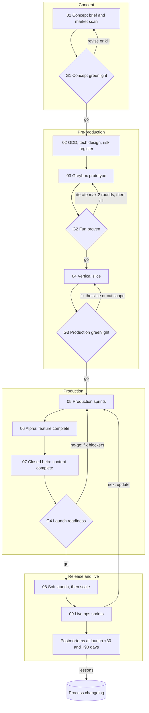

# How we make a Roblox game

This is our production process. It follows the stage-gate model that professional game studios use. Each phase ends at a gate, which is a formal go or no-go review against written criteria. Money and time only go into the next phase once the current one has proved its point. A game can be killed at any gate, and killing a game early is a good outcome, because it means the gate did its job.

This document changes over time. Every gate review, milestone retro and postmortem ends by asking what the process got wrong, and the answers land in the [changelog](#process-changelog) at the bottom. See [Keeping this process current](#keeping-this-process-current).

The styled version with the diagram is the [Roblox Game Pipeline](https://claude.ai/artifact/7YLDNGR8ie3QxgZ1b4REro) page.

## Roles

We are a small team, so one person covers several studio roles. The gates still need someone to hold each role, so the reviews stay honest.

| Studio role | Who | Responsibilities |
|---|---|---|
| Producer and creative director | Yazeed | Owns the vision, the schedule and the backlog. Chairs every gate and makes the go or no-go call. |
| Design | Claude design thread, with Yazeed editing | Concept brief, GDD, economy and progression tuning, store copy |
| Engineering | Claude feature threads, with Yazeed reviewing | Tech design, feature PRs, tests, performance and security work |
| QA | A Claude QA thread runs test plans and triage. Outside testers play. | Test plans per milestone, the bug database, device testing, regression passes |
| Art, level design, UI | Yazeed in Studio, plus contractors when a slice needs it | Maps, models, UI layout, effects |
| Analytics | Claude analytics thread | Event plan, dashboards, weekly KPI report, A/B test readouts |

Nobody approves their own work at a gate. A Claude thread prepares the gate packet and gives a recommendation, and Yazeed decides.

## Phases and gates

### Phase 0: Concept

**01 Concept brief and market scan** ([template](templates/concept-brief.md))
- Write the hook in one sentence, the target audience and age band, the platform mix (phone first unless the brief says otherwise), session length, and the player count per server.
- Run a competitive scan. Search Roblox for the genre, its obvious names and close variants. List the top comparable experiences with their visits, favorites and live player counts. Yazeed reads the live counts on Roblox directly, because they cannot be read from a Claude session.
- Name the differentiator. It has to change the core loop, not just the theme.
- Write a monetization hypothesis, a rough scope in weeks, and the top three risks.

**G1 Concept greenlight**, held with the [gate review template](templates/gate-review.md)
- No direct copy of the idea already exists on Roblox.
- Comparable games show there is an audience for the genre.
- The differentiator is clear enough that a stranger can repeat it back.
- Scope fits the team: MVP in about 8 weeks of production.

### Phase 1: Pre-production

Pre-production exists to retire risk cheaply. Nothing here is built to ship.

**02 GDD, tech design and risk register** ([GDD template](templates/gdd.md))
- **The GDD** covers the core loop at three timescales (30 seconds, 5 minutes, a full session), progression, the economy, the monetization plan, the MVP feature list with an explicit cut list, and the KPI targets the game must hit.
- **The tech design** covers the client and server split, the remote events and their validation, the data model and DataStore schema, the libraries to use, and a performance budget.
- **The risk register** lists each risk with its likelihood, impact, owner, and the prototype or spike that will retire it.

**03 Greybox prototype**
- Grey parts and no art. Time-box it to 1 to 2 weeks.
- Build only what is needed to answer the risk register's open questions, starting with "is the core loop fun?"
- Prototype code is allowed to be messy, but it still lives in git.

**G2 Fun proven**
- At least 8 outside players run through the [playtest protocol](#playtest-protocol), in at least 2 sessions.
- Most testers would play again, and a clear majority finish a full session without being prompted.
- The highest risks in the register are retired or have a plan.
- If the game fails G2 twice, it is killed or goes back to concept. Do not polish an unfun loop.

**04 Vertical slice**
- One complete slice of the game at shipping quality: final art for one area, real UI, sound, the tutorial, saving, mobile controls and analytics events.
- It proves the team can hit the quality bar, and it shows how long content really takes to make.

**G3 Production greenlight**
- The slice meets the [quality bars](#quality-bars) on our device matrix.
- A playtest of the slice holds up or improves on the G2 results.
- The production schedule gets re-estimated from real slice timings, broken into milestones with acceptance criteria.
- The KPI targets in the GDD get reviewed against comparable games and locked.

### Phase 2: Production

**05 Production sprints**
- Two-week sprints. The backlog lives in GitHub Issues and is tracked on a GitHub Project board.
- Each sprint ends with a playable build on the test place, a sprint review where Yazeed plays it, and a short retro.
- Every change goes in through a pull request and must meet the [Definition of Done](#definition-of-done).
- Milestones are tagged builds (`v0.x.0`) with written acceptance criteria. A milestone is not done until QA signs off against them.

**06 Alpha: feature complete**
- Every MVP feature is in and playable end to end. Placeholder art is still allowed.
- QA runs a full test plan pass. Run the economy simulation and tune it.
- Exit when there are no open S1 bugs and the full first-session funnel is instrumented.

**07 Closed beta: content complete**
- All launch content is in. From here, only bug fixes and tuning go in.
- Run a closed beta with 30 to 100 outside players on a private place, and read the funnel and the retention.
- Run the performance pass, the security pass and the compliance review (see [quality bars](#quality-bars)).
- Bug bash: the whole team plays to break the game for a day.

**G4 Launch readiness (go or no-go)**, using the [launch checklist](templates/launch-checklist.md)
- Zero open S1 or S2 bugs.
- Every quality bar passes on the device matrix.
- Beta retention and session length are at or near the GDD targets. If they are not, the gate decides to fix them before launch, or to launch knowingly with the gap.
- The store page, the monetization, the compliance questionnaire and the support plan are done.
- A rollback plan is written down: which place version to revert to, and who does it.

### Phase 3: Release and live

**08 Soft launch, then scale**
- Go public with a small ads or sponsored-experience budget, so a first wave of real players arrives that we can measure.
- Watch error logs, DataStore failures and the funnel daily for the first week. Hotfixes follow the [release process](#release-process).
- Only scale paid acquisition once retention holds at the soft-launch numbers.

**09 Live ops sprints**
- Keep the same two-week cadence. Each update has one goal, tied to the weakest KPI.
- Plan a content and event calendar a month ahead.
- A/B test monetization and onboarding changes where the player count allows a readable result.
- Hold a weekly KPI review: D1, D7 and D30 retention, average session length, concurrent players, payer conversion and revenue per daily user.

**Postmortems** at launch +30 and +90 days, using the [postmortem template](templates/postmortem.md): what went right, what went wrong, and what we change in this process.

## Quality bars

These are our default bars. Each game's tech design can tighten them, but it cannot loosen them without a gate decision.

**Performance**
- Device matrix: a low-end Android phone, an iPhone, a tablet, a Windows PC and a Mac. Add Xbox or VR only if the GDD targets them.
- Hold a steady 60 FPS on PC and on mid-range phones. On the low-end phone the floor is 30 FPS.
- Players should be able to play within about 10 seconds of joining. Use streaming and lazy-load anything big.
- Keep client memory comfortably below the point where low-end phones start crashing. Check it with the Developer Console and the MicroProfiler before every milestone.

**Security**
- The server is authoritative. The client never decides currency, damage, rewards or purchases.
- Every RemoteEvent and RemoteFunction checks its argument types and ranges, checks who is calling, and is rate-limited.
- Developer product purchases are granted only in `ProcessReceipt`, and only once per receipt.
- Before beta, run an exploit pass that fires every remote with bad, huge and spammed arguments.

**Data**
- Use one versioned save schema per game, with session locking (ProfileStore or an equivalent), retries, and a migration path for each schema change.
- Loss of save data is always an S1 bug.

**Compliance**
- Follow Roblox Community Standards and the Terms of Use.
- Fill in the maturity and compliance questionnaire, and keep it accurate after every update.
- Run all user-written text through Roblox text filtering.
- Paid random items show their odds and are gated through `PolicyService`.
- No dark patterns aimed at children: no fake timers, no pay-to-skip on frustration that we designed in, and clear prices.

**Accessibility and UX**
- Text is readable on a phone. Touch targets are big enough for a thumb. Information is never carried by color alone.
- The first-time experience teaches by doing, in under 2 minutes.

## Definition of Done

A pull request is mergeable only when all of these are true. The repo's PR template carries this as a checklist.

- CI is green: StyLua, Selene, the specs (run with Lune) and the Rojo build.
- Pure game logic has TestEZ specs. Rules live in plain modules with no services or Instances, so the specs run in CI as well as in Studio.
- Numbers a designer will tune live in one tuning module per game.
- The pull request says what was verified and how, and what was not. Anything that can only be proved in Studio has a step in the game's playtest script.
- It was tested in Studio on at least a phone emulator and a PC.
- New remotes follow the security bar. New saved fields follow the data bar.
- Analytics events have been added for any new step in the player funnel.
- Yazeed or a second Claude review thread has reviewed it. The author does not review their own work.

## Playtest protocol

Template: [playtest report](templates/playtest-report.md).

1. Recruit testers who did not make the game and who match the target audience as closely as you can.
2. Write down what the session needs to learn before it starts, taken from the risk register or the KPI gaps.
3. Watch without helping. Note every place a tester gets stuck, confused or bored, and at what minute.
4. Afterwards, ask the same short survey every time: fun from 1 to 5, would they play again, what was confusing, and what they would tell a friend this game is.
5. Write the report the same day: the findings ranked by severity, and the backlog items they create.

## Bug severity

| Severity | Meaning | Ship rule |
|---|---|---|
| S1 | Crash, save data loss, purchase not granted, an exploit that breaks the economy | Blocks any release. Hotfix if it is live. |
| S2 | A core feature broken, or a progress blocker with no workaround | Blocks launch. Fix in the current sprint. |
| S3 | A feature works badly but has a workaround | Triaged into the backlog |
| S4 | Cosmetic, or a typo | Fixed when convenient |

Bugs are GitHub Issues with a severity label, steps to reproduce, the device, and the build version.

## Release process

1. Each game has three places: **test** (sprint builds), **staging** (release candidates) and **live**.
2. A release candidate is tagged in git, built with Rojo, and published to staging.
3. QA runs a smoke test and a regression pass on staging.
4. Yazeed publishes to live and writes release notes. Major updates go out early in the week, with someone available to watch for problems afterwards.
5. If something breaks live, revert to the previous place version from version history, then fix forward.

## Where code goes

- `games/<game-name>/` holds one game: its Rojo project, `wally.toml`, `src/` and `tests/`. The README covers setup and adding a game.
- `shared/` holds Luau libraries reused across games. It stays empty until a second game needs something.
- `games/<game-name>/docs/` holds the game's own working documents, such as its tech design, risk register and playtest scripts.
- `tools/run-specs.luau` runs a game's TestEZ specs outside Studio with Lune. CI runs it on every pull request, together with StyLua, Selene and a Rojo build.
- `docs/templates/` holds the documents each stage produces. Copy a template into the game's thread or Claude Doc, or into `games/<game-name>/docs/`.

## Keeping this process current

This process is meant to improve with every game we make.

- **When.** Hold a retro at the end of every sprint, a short "what should the process change" item at every gate review, and a full postmortem at launch +30 and +90 days.
- **How.** Every lesson that should change how we work becomes an edit to this file, made through a PR titled `Process: <what changed>`, plus one line in the changelog below. Process changes are reviewed and merged by Yazeed, just like code.
- **Claude threads.** A Claude thread that sees the process fail, or a step that is missing, wasteful or unclear, proposes the edit on the spot instead of working around it. `CLAUDE.md` makes this a standing rule.
- **Evidence.** Each changelog line says what happened that led to the change, so we can later tell whether the change helped.

## Process changelog

| Date | Change | Why |
|---|---|---|
| 2026-10-26 | First version: 8 stages and 4 informal gates | Initial setup |
| 2026-10-26 | Rebuilt on the studio stage-gate model: added the vertical slice, alpha, beta, the go or no-go gate, quality bars, Definition of Done, bug severity, the release process and postmortems | Yazeed asked for the same rigor as professional development agencies |
| 2026-10-26 | The originality check at G1 has to look for direct copies before any idea is recommended, and live player counts come from Yazeed | Two concepts (a trap race and an Overcooked-style game) turned out to already exist on Roblox |
| 2026-10-26 | Specs run outside Studio with Lune (`tools/run-specs.luau`), and CI runs them along with a Rojo build. The Definition of Done asks for rules in plain modules, one tuning module, and a written list of what was and wasn't verified. | Claude threads can't open Studio, so "specs pass in Studio" could never be checked on a Claude PR. The Countdown Crew greybox had 39 specs that only CI could run. |
| 2026-10-26 | Every greybox ships with a playtest script whose first part is a solo smoke test that Yazeed runs before inviting testers | Code written in the cloud reaches Studio untested. A 10-minute smoke test stops a broken build from wasting a session with outside testers. |
