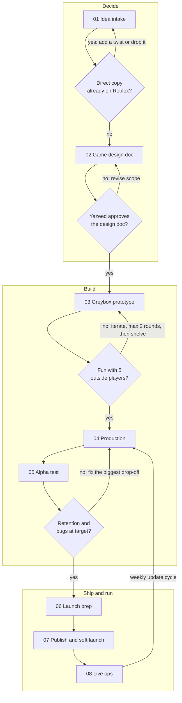

# How we make a Roblox game

Eight stages take a game from a raw idea to live ops. Four gates stop weak ideas early, while they are cheap to kill. Yazeed makes the call at every gate; a Claude thread brings the evidence and a recommendation. The same workflow, styled, is on the [Roblox Game Pipeline](https://claude.ai/artifact/7YLDNGR8ie3QxgZ1b4REro) page.

## Stages

| # | Stage | Owner | Output | Gate before moving on |
|---|-------|-------|--------|------------------------|
| 01 | Idea intake | Yazeed brings the idea, a Claude thread writes it up | One-page concept: hook, the game it is like, player count, session length, audience | Not a direct copy of a game already on Roblox |
| 02 | Game design doc | Claude thread drafts, Yazeed edits | Core loop (every 30 seconds, 5 minutes, per session), progression, MVP list, what is cut, monetization | Yazeed approves; the MVP fits in about 6 weeks |
| 03 | Greybox prototype | Yazeed in Studio, Claude threads write the Luau | Playable core loop with grey parts and no art (1 to 2 weeks) | Fun with 5 outside players; shelve after 2 failed rounds |
| 04 | Production | Claude threads open one PR per feature, Yazeed reviews and builds maps and art | MVP: saving, UI, tutorial, sound, art, mobile controls, analytics events | |
| 05 | Alpha test | Yazeed runs sessions, a thread reads the analytics | Playtests with 20+ outside players, a new-player funnel, a bug list | No crash or data-loss bugs; day-1 return rate hits the target set in the design doc |
| 06 | Launch prep | Yazeed, a thread drafts store copy and the checklist | Icon, thumbnails, description, priced passes and products, maturity questionnaire, odds for any paid random items | |
| 07 | Publish and soft launch | Yazeed | Public game, small ad or sponsored-experience budget | |
| 08 | Live ops | A recurring thread reads the Creator Dashboard weekly, Yazeed picks the update | Weekly report on retention, session length, concurrents and payer rate, then one focused update | Loops back to production |

## Gate checks in practice

- **Originality.** Search Roblox for the genre and its obvious names before recommending anything. A twist has to change the core loop, not just the theme. Live player counts cannot be read from a Claude session, so Yazeed checks them on Roblox directly.
- **Fun.** Testers did not make the game and play for 15 minutes. The signal is whether they ask to play again.
- **Ready.** Targets for retention come from the design doc, so the bar is set before anyone sees the numbers.

## Where code goes

- `games/<game-name>/` holds one game: its Rojo project, `wally.toml`, `src/` and `tests/`. The README covers setup and adding a game.
- `shared/` is for Luau libraries reused across games. It is empty until a second game needs something.
- Every change lands through a pull request, and CI runs StyLua, Selene, the specs and a Rojo build on each one.
- Playtest scripts for each gate live in `games/<game-name>/docs/`.

## Definition of done for a pull request

A pull request is ready for Yazeed's review when:

1. CI is green: formatting, lint, specs and the Rojo build.
2. New rules (scoring, timers, what a station accepts) live in plain modules with specs. Code that needs a running game is kept thin around them.
3. Numbers a designer will tune are in one tuning module, not scattered through the code.
4. The description says what changed, what was verified and how, what was not verified, and the exact steps to try it in Studio.
5. Anything the change can only prove in Studio has a step in the game's playtest script.

## Lessons learned

Add to this list whenever a game teaches us something about the process. Newest first.

- **2026-10-26, Countdown Crew greybox.** Claude sessions in the cloud can't open Studio, and can't reach Roblox's web APIs. So every game's rules go in plain modules that run under Lune in CI, and each gate gets a written playtest script with a solo smoke test that Yazeed runs before inviting testers. Type checking (luau-lsp analyze) isn't in CI yet; Studio's Script Analysis is the type check until it is.
- **2026-10-26, idea stage.** Two ideas failed the originality gate after the design doc was written (an Ultimate Chicken Horse-style game, then an Overcooked-style cooking game). The search for direct copies now happens before the design doc, not after. A theme-only twist is not enough: the twist changes the loop (here, one rocket per countdown that launches at T-0 whatever its state).
